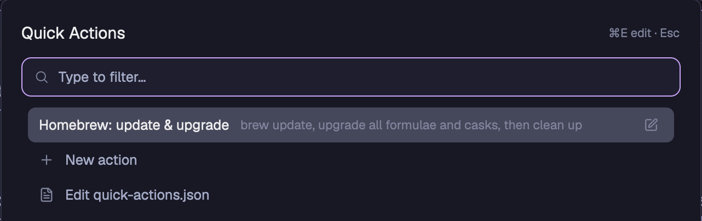

# Quick Actions for Herdr

A popup launcher for your own one-off commands, for the [Herdr](https://herdr.dev/) desktop app. Press the key you bound (`cmd-shift-a` on macOS by default), find an action, and press Enter. It runs in the folder you are working in.



## Install

Ask your agent, in Herdr, to add this mod:

```text
https://github.com/giorgiostokje/herdr-quick-actions
```

The mod runs commands that you write, through `hc` and `sh`. It reads and writes `~/.config/herdr-app/quick-actions.json`, and it does not reach the network.

Merge the key file for your system into your own `keys.json`:

| System | File | Key |
|---|---|---|
| macOS | `keys.macos.json` | `cmd-shift-a` |
| Linux | `keys.json` | `ctrl-shift-a` |

These keys are suggestions. If you already use the key, your agent asks before it replaces it, or you can pick any free key.

## Platforms

- **macOS:** tested.
- **Linux:** should work, but it is not tested yet.
- **Windows:** not supported, because actions run through `sh`.

## Add actions

Select **New action** in the popup, or select **Edit quick-actions.json** to edit the file itself. The file is a list:

```json
[
  { "name": "Update", "description": "Upgrade my packages", "command": "brew upgrade" },
  {
    "name": "Search",
    "command": "open \"https://example.com/?q=$VALUE_URLENCODED\"",
    "input": { "prompt": "Search for" }
  },
  {
    "name": "Deploy",
    "command": "./deploy \"$VALUE\"",
    "input": { "choices": ["staging", { "label": "Live", "value": "prod" }] }
  },
  {
    "name": "Open",
    "command": "code \"$VALUE\"",
    "input": { "choices_command": "ls -1" }
  }
]
```

With `input`, the popup asks you for a value first. The command gets your answer in 2 shell variables:

- `$VALUE` is the answer as you gave it.
- `$VALUE_URLENCODED` is the same answer, URL-encoded for a query string. A space becomes `+`, and `&` becomes `%26`.

Put them in double quotes. Then an answer with spaces or `;` cannot break the command.

`choices_command` prints one choice per line. Write `label`, or `label`, a tab, then `value`.

## Running actions

A running action opens its terminal over the tab, with 3 buttons:

- **✕ stop** ends the command.
- **– minimize** hides the terminal. The command keeps running, and you bring it back from **Running** in the popup.
- **↗ keep as tab** moves it to a normal tab.

A command that fails keeps its terminal open, with the exit code, until you press Enter.

## Limits

- Actions cannot appear in the command palette, because Herdr has no way for a mod to add entries yet ([#211](https://github.com/herdrdev/herdr-app/issues/211)).
- On a window shorter than about 920 px, the tallest form may be cut off. ⌘Enter (Ctrl+Enter on Linux) saves it.

## License

[MIT](LICENSE)
