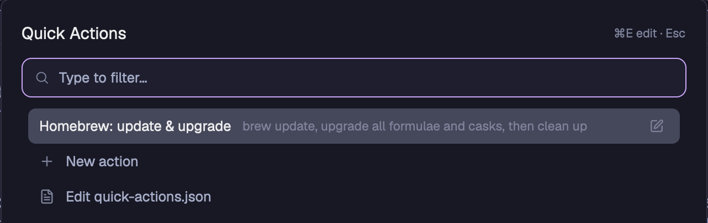

# Quick Actions

A popup launcher for your own one-off commands. Press a key, type a few letters to find an action, and press Enter. The command runs in the folder you are working in, in its own terminal over the tab. You can stop it, minimize it or keep it as a tab. You create and edit actions in the popup, or in a JSON file.



## What you see

- **Popup:** at the top of the window, 40 px down, 640 px wide, at most 80% of the window height. It uses the `popover` background and 18 px padding, like the shipped picker and palette.
- **Header row:** "Quick Actions" at 15 px semibold on the left. On the right, a 11 px dim hint: "⌘E edit · Esc" (on Linux, "Ctrl+E edit · Esc"), "Esc to go back" or "Starting…".
- **Search box:** 36 px high, with an accent border, the `mods/workspace-chrome/search.svg` icon and the placeholder "Type to filter…".
- **List:** rows of 32 px, at most 10 at a time. Each row has the name, then a dim description. Action rows have a pencil icon on the right.
- **Last rows:** "New action" with a plus icon, and "Edit quick-actions.json" with a file icon.
- **Running heading:** when actions are running, they are listed under "Running" above an "Actions" heading.
- **Problems:** a bad entry in the file shows as a row in the `blocked` color, with its number and the reason.
- **Form (New action, or the pencil):** Name, Description, Command, "Before it runs" with 4 options and an explanation line, then the fields for the option you chose. Buttons at the bottom: Delete (when editing), Cancel, Save.
- **Raw editor ("Edit quick-actions.json"):** a JSON code editor, 440 px high, with the file path under it, then Cancel and Save.
- **Running action:** a dialog at 80% of the window with a 34 px bar on top of the terminal. The bar has the action's name, "– minimize", "↗ keep as tab" and "✕ stop".

## How it behaves

- **Filter:** letters match in order, best near the start of a word. Names count more than descriptions.
- **Keys:** ↑/↓ and Ctrl+N/Ctrl+P move, Page Up/Page Down move by 10, Enter runs, ⌘E edits the selected action, Esc closes or goes back. In the form, Tab moves between fields and ⌘Enter saves. On Linux, Ctrl replaces ⌘.
- **Before it runs:** an action can run right away, ask you to type, let you pick from a list in the file, or let you pick from the output of a second command.
- **The answer:** the command gets it as `$VALUE`, and URL-encoded as `$VALUE_URLENCODED`. These are shell variables, so an answer with spaces or `;` cannot break the command when you quote them.
- **Running:** a command that ends within about 150 ms opens no terminal. A command that fails keeps its terminal open with the exit code until you press Enter.
- **Stop:** "✕ stop" ends the command. "– minimize" only closes the dialog: the command keeps running, and you bring it back from "Running" in the popup. Clicking beside the dialog also closes it without stopping the command.
- **Agent status:** this mod shows none. Actions are plain terminals.

## Built from

- **Mods:** `quick-actions` only, in `mods/quick-actions/`. `main.js` is the view, and `logic.js` has the file format, the form logic, the shell script and the filter, with no window code. `logic.test.mjs` tests `logic.js` with `node --test`.
- **Shipped icons:** `search.svg`, `plus.svg`, `square-pen.svg` and `file-text.svg` from `mods/workspace-chrome/`.
- **Opening:** `mod.json` has `"place": "none"` and a popup overlay. `keys.macos.json` binds `cmd-shift-a` to `mod.open:quick-actions`, and `keys.json` binds `ctrl-shift-a` for Linux. Merge only the file for your system: if one action has keys for several systems, Herdr can show the wrong one.
- **Running dialog:** `openOverlay` with `kind: "dialog"` and a layout of two blocks: this mod with props `{ part: "bar", terminal, name }`, and `{ terminal }`.
- **Herdr functions:** `window` (`platform` picks ⌘ or Ctrl), `exec`, `hc`, `readTextFile`, `writeTextFile`, `shared`, `setShared`, `focused`, `spaces`, `terminals`, `theme`, `settings`, `notify`, `openOverlay`, `closeOverlay`, `run`, `home`, `appHome`, `props`.
- **Commands:** `terminal.kill` and `terminal.keep`.
- **Programs it runs:** `hc run`, `hc get` and `sh -c`, with the commands you write. It reads and writes `~/.config/herdr-app/quick-actions.json`. It does not reach the network.
- **The file:** a list, shown in file order:

  ```json
  [
    { "name": "Update", "description": "Optional", "command": "brew upgrade" },
    { "name": "Search", "command": "open \"https://example.com/?q=$VALUE_URLENCODED\"", "input": { "prompt": "Search for" } },
    { "name": "Deploy", "command": "./deploy \"$VALUE\"", "input": { "choices": ["staging", { "label": "Live", "value": "prod" }] } },
    { "name": "Open", "command": "code \"$VALUE\"", "input": { "choices_command": "ls -1" } }
  ]
  ```

  `choices_command` prints one choice per line: `label`, or `label<tab>value`.

## Watch out

- **Platforms:** tested on macOS. Linux should work, but it is not tested yet. Windows is not supported, because actions, `choices_command` and the failure message all use `sh` and `/dev/tty`.
- **The first frame:** a file read finishes after the first frame, and the redraw then held the app up for about a second. So the rows are drawn from a copy in `shared("quick-actions.file")`, and the file is read 150 ms later. After a hand edit, the first open shows the old list for a moment.
- **A new terminal is listed late:** Herdr 0.1.12 lists a terminal in `terminals()` about 300 ms after `hc run --bg` returns. A single `terminals()` check 150 ms after the start never finds it, so the dialog never opens. Instead, ask the core after 150 ms with `hc get --json <t>` (a finished `--rm` terminal answers `not_found`), then wait until `terminals()` lists the terminal before you open the dialog.
- **Do not use `localStorage` for that copy:** an overlay's store is per overlay id, so it is empty on each open and leaves a new file behind.
- **Keep the file out of the mod folder:** saving any file in the folder reloads the mod, which would reset an open form.
- **A broken file:** the form must not overwrite it. "New action" is hidden, and "Edit quick-actions.json" stays so it can be repaired.
- **Saving:** `writeTextFile` gets the text as read, so a file that changed in the meantime is refused and the draft stays.
- **Do not make the form scroll:** in a popup that fits its content, an `overflow_y_scrollbar` area collapses to height 0, and a mod cannot read the window size to set one. On a window shorter than about 920 px, the tallest form may be cut off.
- **Palette:** mods cannot add entries to the command palette (herdrdev/herdr-app#211).
- **Editor focus:** `EditorState` has no `focus()`, so you click in the raw editor before you type.

## Done when

- `node --test mods/quick-actions/logic.test.mjs` passes and `herdr-app check` passes.
- With no file, the popup shows "New action" and "Edit quick-actions.json", and saving a new action creates the file.
- An answer of `a b; touch x` reaches the command unchanged as `"$VALUE"`, and no file named `x` appears.
- A command that runs for a few seconds opens its dialog, and `true` opens none.
- "✕ stop" ends a running command. "– minimize" leaves it listed under "Running", and selecting it there brings it back.
- A command that exits with code 7 shows that code and waits for Enter.
- A file with invalid JSON shows a red row, and Save in the raw editor refuses invalid JSON.
- A file changed on disk while the form is open is not overwritten.
